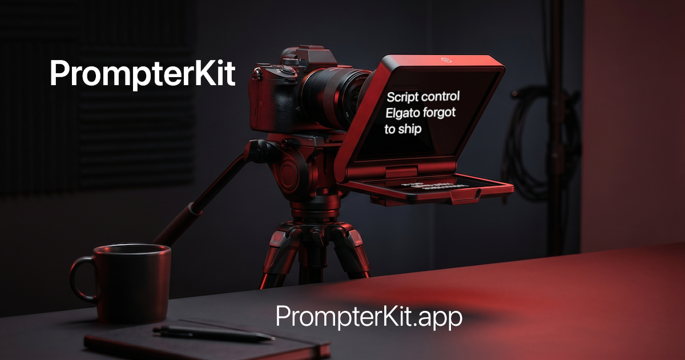

# PrompterKit



Manage Elgato Prompter scripts through a local web GUI or CLI: import text and
Markdown, export text, rename, delete, reorder, and create library backups.

Site: https://prompterkit.app/
Repo: https://github.com/snapsynapse/prompter-kit

> Maintenance-only, reviewed September 2026. No feature development or Camera
> Hub compatibility tracking is planned. Security reports receive best-effort
> review, with no guaranteed response or fix timeline. Forks are welcome.
> Safeguards reduce some write risks; they do not guarantee compatibility or
> recovery. See [SECURITY.md](SECURITY.md) and [ROADMAP.md](ROADMAP.md).

Based on [spieldbergo/elgato_prompter_text_importer](https://github.com/spieldbergo/elgato_prompter_text_importer) (MIT).

## Requirements and compatibility

- Python 3.10+; Flask is required for the GUI.
- Elgato Camera Hub installed on macOS or Windows.
- Automated tests use sanitized fixtures. The June 2026 macOS live eval passed,
  but did not record the Camera Hub version. This is not certification of all
  Camera Hub 2.x releases or of the version currently installed on your machine.
- Close Camera Hub before writes. Test against a copied data directory first
  when compatibility is uncertain. Do not run simultaneous writers.

## Install

### AI-assisted install

The [assistant guide](https://prompterkit.app/.well-known/assistant-guide.txt)
provides structured setup actions and approval gates. Explain and approve
commands individually; do not upload local scripts or backups to an assistant.
Guide 1.4.0 targets the [GuideCheck](https://guidecheck.org/) 0.7.1 profile and publishes
a [manifest](https://prompterkit.app/.well-known/assistant-guide-manifest.txt)
and [hash record](https://prompterkit.app/.well-known/assistant-guide-transparency-log.txt).
The repository checks copy and hash consistency, not full GuideCheck conformance.
Use the [verifier](https://guidecheck.org/verify) to assess conformance; neither
conformance nor matching hashes establish software safety.
Level 4 is the guide-file target, not an achieved claim here. Level 5 requires
a separate enforcing runtime. The corrected guide passed local Level 3 checks
on 2026-09-05 with no blocking findings or warnings. Public Level 4 requires
the v1.0.3 guide release and matching live provenance; consult the hosted
verifier and release notes for dated results. It installs the
reviewed app 1.0.2 with script hash checks. See [publishing and DNS steps](CONTRIBUTING.md#dns-provenance).

### Terminal install

On macOS or a POSIX shell, from the parent directory where you want the repo:
Literal
```sh
git clone https://github.com/snapsynapse/prompter-kit.git
cd prompter-kit
python3 -m venv .venv
source .venv/bin/activate
python3 -m pip install -r requirements-gui.txt
```
On Windows, activate with `.venv\Scripts\activate` instead.
Close Camera Hub, then launch from the activated environment:
Literal
```sh
python3 prompter_kit_gui.py
```
The GUI opens on loopback address `127.0.0.1`, port `5000`. It supports
import, export, rename, delete, and an explicit Normalize indexes command.
It does not automatically normalize indexes or provide arbitrary reorder.
GUI Export all produces a ZIP of text files, not a backup accepted by `restore`.

### Homebrew (CLI only)

The separate [Homebrew tap](https://github.com/snapsynapse/homebrew-tap) installs
the CLI; its packaged version may lag the source release.
Literal
```sh
brew install snapsynapse/tap/prompter-kit
prompter-kit doctor
```

## CLI

Run from the activated environment in the repository. Inspect commands with:
Literal
```sh
python3 prompter_kit.py --help
python3 prompter_kit.py import --help
```
Replace: SCRIPT_PATH -> path to your UTF-8 .txt or .md file
Replace: SCRIPT_NAME -> desired display name
Customize
```sh
python3 prompter_kit.py import "SCRIPT_PATH" --name "SCRIPT_NAME"
```

| Command | Behavior |
|---|---|
| `import` / `push` | Import text; .md formatting is stripped. --restart stops and restarts Camera Hub. |
| `export` / `pull` | Export by --name or --guid; --all exports a directory; --list lists scripts. |
| `rename` / `delete` | Change a friendly name or remove a script and its registration. |
| `reindex` | Set order from names/GUIDs, or normalize current order when none are given. |
| `edit` | Open chapters in $EDITOR. |
| `backup` | Archive registered readable scripts plus the full AppSettings.json. |
| `restore` | Replace library and settings from a backup; --merge adds unregistered GUIDs. |
| `doctor` | Inspect paths, registration, missing scripts, and process state. |
| `camerahub stop` / `start` | Control the local application. |

Most data commands accept `--base-dir` after the command name. The GUI uses
`PROMPTERKIT_BASE_DIR`; set `PROMPTERKIT_OPEN_BROWSER=0` to suppress auto-open.
Single-file export overwrites its chosen destination. Export-all avoids names
already present in the destination directory and assigns distinct filenames
within each run, including case-only collisions. Concurrent exports are unsupported.

## Text format

UTF-8 .txt imports preserve literal punctuation, Markdown markers, and spaces
on nonblank lines. .md imports strip common Markdown formatting using a simple
line-based converter, not a complete Markdown parser. Use .txt for literal text.
Both formats normalize CRLF/CR to LF, treat blank or whitespace-only lines as
chapter separators, collapse repeated separators, and discard empty chapters.

Export places a blank line between chapters and preserves single newlines
inside them. Export and re-import preserve chapters that follow this convention;
they do not preserve empty chapters or blank lines embedded within a chapter.
Export adds a final newline. Use JSON backups when text conversion would lose
structure you need to retain. Before 1.0.2, .txt imports also stripped Markdown.

## Backup scope and restore

Close Camera Hub before backup to avoid capturing files while they change.
Choose a new archive path; an existing archive at that path is overwritten.
Replace: BACKUP_PATH -> new path for your backup ZIP
Customize
```sh
python3 prompter_kit.py backup --output "BACKUP_PATH"
```
Backups contain the full `AppSettings.json` and registered script JSON files
that can be read and parsed. Missing or corrupt script files, unregistered
files, and other Camera Hub data are excluded. Backups can contain private
scripts and settings; keep them local and protected.

Replace restore replaces the entire `Texts/` directory and the full settings
file, including unrelated Camera Hub settings. Unregistered files in that
directory are removed and are not covered by the automatic snapshot. Preserve
an independent copy of the entire data directory before using replace restore.
Merge restore keeps registered GUIDs, but can overwrite an unregistered file
whose GUID matches an incoming script. Check `doctor` warnings first.

## Safeguards and limits

- Import, rename, delete, reindex, and edit check known schema fields before
  mutation. Missing and unparseable script files are tolerated. This cannot
  detect every future format change. Read operations may also fail on unknown data.
- These operations normally create registered-library snapshots in
  `PrompterKitBackups/`, with a retention limit of 20. Snapshots can be disabled
  with `PROMPTERKIT_AUTO_BACKUP=0` and have the exclusions described above.
- Restore bypasses the live schema check and uses a best-effort snapshot so
  corrupt live data does not block recovery. Use a trusted, compatible archive.
- JSON file replacement is atomic per file, not across the library. Immediate
  verification detects some failures but cannot prevent later Camera Hub writes.
- Import removes its new script file when settings registration fails. Replace
  restore stages files and attempts rollback on swap or verification failure.
  Merge restore attempts file rollback on write failure before settings commit.
  Filesystem failures can also prevent rollback; recovery is not guaranteed.

## Data locations

| Platform | Path |
|---|---|
| macOS | `~/Library/Application Support/Elgato/Camera Hub/` |
| Windows | `%APPDATA%\Elgato\Camera Hub\` |

PrompterKit falls back to the legacy `CameraHub` directory if only it exists.
See [ARCHITECTURE.md](ARCHITECTURE.md) for the supported data shape.

## Verification and contributions

Install test dependencies using [CONTRIBUTING.md](CONTRIBUTING.md), then:
Literal
```sh
python3 -m pytest tests/ -q
python3 scripts/check_agent_surfaces.py
```
The suite covers conversion, CRUD, restore failures, GUI routes, and fixtures.
The GUI smoke eval uses a disposable copy:
Literal
```sh
scripts/gui_smoke_eval.sh
```
The optional live eval backs up registered data, temporarily imports and deletes
a script, and stops/restarts Camera Hub. Inspect the script before using it:
Literal
```sh
scripts/manual_live_eval.sh
```
No new features or compatibility updates are planned. Forks are welcome; review
of reports and contributions is best-effort. License: [MIT](LICENSE).
